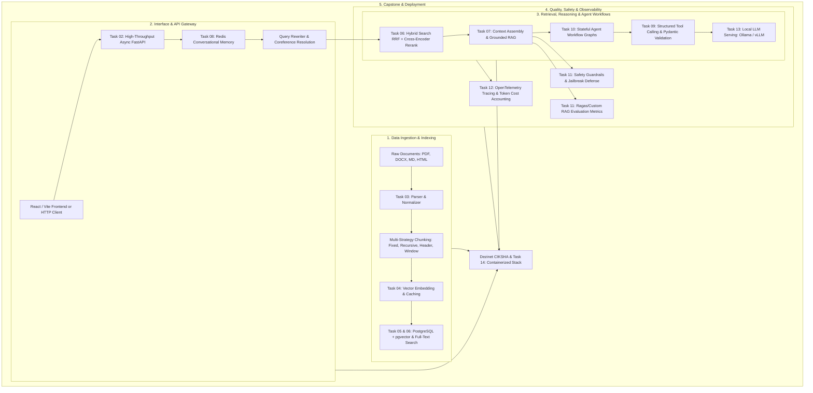

# Enterprise AI & LLM Systems Engineering Portfolio

[](https://www.python.org/)
[](https://fastapi.tiangolo.com/)
[](https://github.com/pgvector/pgvector)
[](https://redis.io/)
[](https://www.docker.com/)
[](https://opentelemetry.io/)
[](https://ollama.ai/)
[](https://github.com/astral-sh/uv)

A production-grade, end-to-end curriculum and capstone implementation demonstrating modern **Applied Generative AI and Large Language Model (LLM) Systems Engineering**.

This repository spans from fundamental low-level async API plumbing, robust document parsing, and high-performance vector indexing to stateful agentic workflows, enterprise hybrid RAG pipelines, safety guardrails, distributed OpenTelemetry tracing, and fully containerized microservice architectures.

---

## 🏛️ System Architecture



---

## 📑 Portfolio Curriculum & Modules

| Module / Directory                                                                | Focus Area                                    | Key Technologies                                              | Description                                                                                                                                          |
| :-------------------------------------------------------------------------------- | :-------------------------------------------- | :------------------------------------------------------------ | :--------------------------------------------------------------------------------------------------------------------------------------------------- |
| **[`dezinet-ciksha/`](./dezinet-ciksha)**                                         | **Enterprise AI Knowledge Engine (Capstone)** | React, Vite, FastAPI, pgvector, Redis, Ollama, Langfuse       | Multi-tenant RAG platform featuring SSE streaming, document ingestion, hybrid search, Redis session memory, and telemetry.                           |
| **[`task02_fastapi_async_ai/`](./task02_fastapi_async_ai)**                       | **High-Throughput Async AI Services**         | FastAPI, Pydantic v2, SQLite Async, SSE                       | Non-blocking async endpoints, Server-Sent Events token streaming, dependency injection, custom timing middleware, and structured errors.             |
| **[`task03_unstructured_ingestion/`](./task03_unstructured_ingestion)**           | **Unstructured Ingestion & Chunking**         | `pdfplumber`, `python-docx`, `tiktoken`, BeautifulSoup4       | Multi-format document parser, text normalization, and 4 chunking strategies (fixed-token, recursive, header-aware, sentence-window).                 |
| **[`task04_vector_embeddings/`](./task04_vector_embeddings)**                     | **Embeddings, Math & Caching**                | NumPy, OpenAI API / local mocks, SHA256 Caching               | Dimensionality handling, vector similarity math (Cosine, Euclidean, Dot Product), exponential backoff retries, and hash-based caching.               |
| **[`task05_vector_database_engineering/`](./task05_vector_database_engineering)** | **Production Vector DB Engineering**          | PostgreSQL, `pgvector`, ChromaDB, Docker                      | Vector index tuning (HNSW vs IVFFlat), tenant-isolated schemas, metadata filtering, and query latency/QPS benchmarking.                              |
| **[`task06_hybrid_search/`](./task06_hybrid_search)**                             | **Hybrid Search & Precision Retrieval**       | PostgreSQL FTS (`tsvector`), `pgvector`, SentenceTransformers | Hybrid retrieval merging BM25/FTS keyword search with dense semantic embeddings via Reciprocal Rank Fusion (RRF) and Cross-Encoder reranking.        |
| **[`task07_enterprise_rag/`](./task07_enterprise_rag)**                           | **Enterprise RAG Architecture**               | Pydantic, PostgreSQL, Jinja2, Deterministic Mocks             | Multi-query expansion, context window dynamic budgeting, grounded citation validation, and automated hallucination fallback.                         |
| **[`task08_conversational_memory/`](./task08_conversational_memory)**             | **Conversational Memory Management**          | Redis, FastAPI, Token Budgeting                               | Stateful multi-turn dialogue management, query rewriting, sliding-window buffers, summary buffers, and entity memory tracking.                       |
| **[`task09_structured_tool_calling/`](./task09_structured_tool_calling)**         | **Structured Outputs & Tool Calling**         | Pydantic v2, JSON Schema, Asyncio                             | Robust tool registries, parallel async tool execution, defensive JSON schema parsing, and bounded self-correction retry loops.                       |
| **[`task10_agent_workflows/`](./task10_agent_workflows)**                         | **Autonomous Multi-Step AI Agents**           | State Graphs, TypedDict, Checkpointing                        | Stateful graph orchestration with Planner, Retriever, Controlled Executor, Reviewer loops, conditional branching, and Human-in-the-Loop checkpoints. |
| **[`task11_llm_evaluation_guardrails/`](./task11_llm_evaluation_guardrails)**     | **Evaluation & Safety Guardrails**            | RAG Benchmarks, Regex/Heuristic Classifiers                   | Golden dataset evaluation (MRR, Precision@K, Faithfulness), prompt injection detectors, jailbreak screening, and PII redaction filters.              |
| **[`task12_llm_observability/`](./task12_llm_observability)**                     | **Observability & Cost Tracking**             | OpenTelemetry, SSE Streaming, Tracing                         | Granular root/child span instrumentation, token accounting, cost estimation, and real-time streaming metrics (TTFT, ITL).                            |
| **[`task13_open_source_llm_serving/`](./task13_open_source_llm_serving)**         | **Open-Source LLMs & Quantization**           | vLLM, Ollama, llama.cpp, CLI Benchmarking                     | OpenAI-compatible inference servers, VRAM calculation formulas for FP16/INT8/INT4 (AWQ/GPTQ) models, and concurrency benchmarking.                   |
| **[`task14-ai-stack/`](./task14-ai-stack)**                                       | **Containerized Production AI Stack**         | Docker Compose, Multi-stage `uv` Dockerfile                   | Fully dockerized deployment with FastAPI, PostgreSQL + pgvector, Redis, and Ollama with automated healthchecks and network bridging.                 |

---

## 🚀 Detailed Module Breakdown

### 🌟 Dezinet CIKSHA — Enterprise Knowledge Engine

- **Stack**: React + Vite (Tailwind/Lucide), FastAPI, PostgreSQL + pgvector, Redis, Ollama, Langfuse.
- **Features**:
  - Full-stack multi-tenant web application.
  - Interactive document upload and ingestion with status tracking.
  - Real-time Server-Sent Events (SSE) streaming answers with clickable source citations.
  - Multi-tenant data segregation with SQL tenant partitioning.
  - Pre-configured `docker-compose.yml` spinning up backend, frontend, database, cache, and telemetry.

### ⚡ Task 02 — High-Throughput Async AI Services

- **Focus**: Building scalable async REST APIs tailored for AI workloads.
- **Highlights**:
  - Async request handling without blocking the event loop.
  - Token-by-token streaming responses via Server-Sent Events (SSE).
  - SQLite async sessions with SQLAlchemy and Lifespan state management.
  - Middleware for request duration profiling and standardized error schemas.

### 📄 Task 03 — Unstructured Data Ingestion & Multi-Strategy Chunking

- **Focus**: Robust local-first parsing and chunking for heterogeneous files.
- **Highlights**:
  - Parsers for `.pdf`, `.docx`, `.md`, and `.html` with metadata extraction.
  - Four distinct chunking implementations:
    - **Fixed Token Chunking**: Strict token limits via `tiktoken`.
    - **Recursive Character Chunking**: Natural paragraph and sentence boundaries.
    - **Markdown Header Chunking**: Preserves hierarchical document semantics.
    - **Sentence-Window Chunking**: Retains surrounding sentences for context injection.
  - Formatted JSONL output export.

### 🔢 Task 04 — Vector Embeddings, Similarity Math & Caching

- **Focus**: The mathematical foundations and reliability patterns of vector representations.
- **Highlights**:
  - Implementations of Cosine Similarity, Dot Product, and Euclidean (L2) Distance.
  - Resilient batching pipeline with exponential backoff and jitter for rate-limited APIs.
  - Deterministic SHA-256 embedding caching layer preventing redundant API calls.

### 🗄️ Task 05 — Production Vector Database Engineering

- **Focus**: Enterprise vector storage, indexing, and multi-tenancy.
- **Highlights**:
  - PostgreSQL schema design using `pgvector` with 1536-dimensional vectors.
  - Comparative benchmark between **HNSW** (Hierarchical Navigable Small World) and **IVFFlat** indexes under different dataset sizes.
  - ChromaDB embedded mode integration.
  - Automated benchmark measuring latency percentiles (p50, p95, p99) and queries per second (QPS).

### 🔍 Task 06 — Hybrid Search, Re-Ranking & Precision Retrieval

- **Focus**: Combining dense semantic search with sparse lexical search for high precision.
- **Highlights**:
  - Sparse retrieval using PostgreSQL Full-Text Search (`to_tsvector`, `ts_rank`).
  - Dense retrieval using `pgvector` cosine similarity.
  - Reciprocal Rank Fusion (RRF) algorithm to merge disparate scoring distributions without arbitrary weights.
  - Cross-Encoder re-ranking (`ms-marco-MiniLM-L-6-v2`) to score deep query-document cross-attention.

### 🧠 Task 07 — Enterprise Retrieval-Augmented Generation (RAG)

- **Focus**: High-assurance RAG pipelines that prevent hallucinations.
- **Highlights**:
  - Query transformation: Query expansion and sub-query decomposition.
  - Dynamic token budgeting: Context packing with token allocation limits.
  - Citation validation: Enforcing that factual claims map to explicit retrieved chunk IDs.
  - Fallback mechanism triggering safe responses when retrieval confidence drops below threshold.

### 💬 Task 08 — Conversational Memory & Multi-Turn Context Management

- **Focus**: Long-context dialogue state and persistent user memory.
- **Highlights**:
  - Redis-backed message store with session isolation.
  - Coreference resolution and query rewriting: Converts "What was his score?" into "What was Albert Einstein's physics exam score?".
  - Memory architectures: Sliding window buffer, summary-buffer memory, and entity memory extraction.

### 🛠️ Task 09 — Structured Tool Calling & Resilient JSON Schema

- **Focus**: Reliable schema-guided tool calling and extraction from LLMs.
- **Highlights**:
  - Dynamic Pydantic v2 JSON Schema generation for function signatures.
  - Centralized, typed tool registry.
  - Concurrent async tool dispatching with error boundaries.
  - Defensive parser capable of repairing malformed markdown-wrapped JSON with self-correction retry loops.

### 🕸️ Task 10 — Autonomous Multi-Step AI Agent Workflows

- **Focus**: Deterministic graph-based state machines for autonomous tasks.
- **Highlights**:
  - Typed state transitions across Planner $\rightarrow$ Retriever $\rightarrow$ Executor $\rightarrow$ Reviewer.
  - Conditional edge routing with retry caps and safety halts.
  - Checkpoint persistence storing execution state history in JSON.
  - Human-in-the-Loop (HITL) pause-and-resume gate for privileged actions.

### 🛡️ Task 11 — LLM Evaluation, Benchmarking & Safety Guardrails

- **Focus**: Automated regression testing and security screening for LLM systems.
- **Highlights**:
  - Versioned golden datasets for RAG benchmarking.
  - Quantitative metrics: Context Precision@K, Recall@K, Mean Reciprocal Rank (MRR), and Groundedness.
  - Adversarial guardrail pipeline: Prompt injection detection, jailbreak pattern matching, and automated PII redaction.

### 📊 Task 12 — LLM Observability, Distributed Tracing & Cost Tracking

- **Focus**: Production monitoring and telemetry for multi-step AI pipelines.
- **Highlights**:
  - OpenTelemetry distributed tracing with parent/child spans across ingestion, retrieval, and synthesis.
  - Fine-grained token accounting: Prompt, completion, total tokens, and dollar cost computation.
  - Streaming telemetry measuring Time to First Token (TTFT) and Inter-Token Latency (ITL).

### 🖥️ Task 13 — Open-Source LLMs, Quantization & Serving

- **Focus**: Self-hosted model infrastructure, quantization trade-offs, and throughput.
- **Highlights**:
  - Unified client supporting Ollama, vLLM, and llama.cpp HTTP endpoints.
  - Mathematical VRAM estimator: Calculates memory requirements for weights, KV cache, and context overhead across FP16, INT8, and INT4 (AWQ/GPTQ).
  - Asynchronous load generator for benchmarking requests per second (RPS) and latency distributions.

### 🐳 Task 14 — Containerized AI Pipeline

- **Focus**: Declarative, repeatable container infrastructure.
- **Highlights**:
  - Multi-stage Dockerfile utilizing Astral's `uv` for ultra-fast, lightweight Python builds.
  - Orchestration via `docker-compose.yml` integrating:
    - FastAPI application server
    - PostgreSQL 16 with `pgvector` extension
    - Redis 7 cache
    - Local Ollama LLM container
  - Configured healthchecks, network segmentation, and persistent volume mounts.

---

## 🛠️ Tech Stack & Tooling

- **Languages**: Python 3.11+, JavaScript / TypeScript, SQL (PostgreSQL dialect), Bash / PowerShell
- **Frameworks**: FastAPI, Pydantic v2, React 18, Vite
- **Databases & Vector Storage**: PostgreSQL 16 (`pgvector`), Redis, ChromaDB, SQLite (`aiosqlite`)
- **Package Management**: `uv` (Fast Python package installer and resolver), `pip`, `npm`
- **Containerization**: Docker, Docker Compose
- **Observability**: OpenTelemetry, Langfuse
- **Inference Engines**: Ollama, vLLM, OpenAI API (compatible interfaces)

---

## ⚡ Quick Start Guide

### 1. Prerequisites

Ensure you have the following installed on your system:

- [Python 3.11+](https://www.python.org/)
- [`uv`](https://github.com/astral-sh/uv) (recommended for Python package management):

  ```bash
  # Windows PowerShell
  powershell -c "irm https://astral.sh/uv/install.ps1 | iex"

  # macOS / Linux
  curl -LsSf https://astral.sh/uv/install.sh | sh
  ```

- [Docker & Docker Compose](https://www.docker.com/)

### 2. Environment Configuration

Copy the template configuration files in the desired task directories:

```bash
# Example for Task 14 or Capstone
cp task14-ai-stack/.env.example task14-ai-stack/.env
```

### 3. Running an Individual Python Task (e.g., Task 07 RAG)

```bash
cd task07_enterprise_rag
uv sync
uv run pytest
```

### 4. Running the Full Containerized Stack (Task 14)

```bash
cd task14-ai-stack
docker-compose up -d --build
```

Verify services:

- FastAPI Swagger UI: `http://localhost:8000/docs`
- Health check: `http://localhost:8000/health`

### 5. Running the Capstone Project (Dezinet CIKSHA)

```bash
cd dezinet-ciksha
docker-compose up --build
```

Access the application:

- Frontend UI: `http://localhost:5173`
- Backend API Docs: `http://localhost:8000/docs`

---

## 🧪 Testing

Every task includes automated tests with high code coverage. Run tests across tasks using `uv`:

```bash
# Example: Running tests in task 02
cd task02_fastapi_async_ai
uv run pytest -v

# Example: Running tests in task 10 (Agent Workflows)
cd task10_agent_workflows
uv run pytest -v
```

---

## 👤 Author & Maintainer

- **Developer**: Vishwanath ([@vishwanathdvgmm](https://github.com/vishwanathdvgmm))
- **Repository**: [https://github.com/vishwanathdvgmm/Tasks](https://github.com/vishwanathdvgmm/Tasks)
