# System Architecture

```mermaid
flowchart TD
  U[React UI] -->|Upload / Search / SSE| API[FastAPI API]
  API --> ING[Parse + Recursive Chunking]
  ING --> EMB[Ollama Embeddings]
  EMB --> PG[(PostgreSQL + pgvector)]
  API --> RET[Hybrid Retrieval]
  RET -->|Dense cosine| PG
  RET -->|Lexical full-text| PG
  RET --> RRF[Reciprocal Rank Fusion]
  RRF --> CTX[Grounded Context + Citations]
  CTX --> LLM[Ollama Chat Model]
  API <--> REDIS[(Redis Session Memory)]
  API --> OBS[Timing / tracing hooks]
```

## Request flow

1. Upload is size-checked and parsed according to file type.
2. Text is split into overlapping chunks; each chunk receives an embedding.
3. Document metadata and chunk vectors are inserted into PostgreSQL.
4. A query is embedded and searched using cosine similarity and PostgreSQL full-text search.
5. RRF combines ranked results; the top chunks are placed in a citation-aware prompt.
6. Chat history is read from and written to Redis using a tenant-scoped key.
7. Server-Sent Events carry metadata, answer chunks, completion, or errors.

## Important implementation boundaries

- The included reranking stage is RRF. A learned cross-encoder reranker is a recommended next addition, not implemented in this MVP.
- SSE currently emits text chunks after the full Ollama response is generated. Use Ollama's streaming API to deliver genuine token-by-token TTFT.
- Langfuse credentials are configurable, but this starter does not yet submit Langfuse SDK traces. Wire the SDK around ingestion, retrieval, reranking, and generation before claiming dashboard telemetry.
- Tenant filtering is implemented in application queries. PostgreSQL RLS and authenticated tenant identity are required before production deployment.
